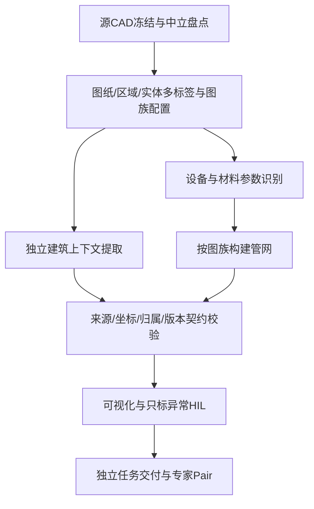

# CAD Pipeline v1.0.0 固化交付

本轮交付：总控 Skill + 三个职责独立的处理 Skill + 可执行任务清单与契约检查 + 审核内容身份修正。已安装到本机 `C:/Users/lenovo/.codex/skills/`。既有 SH16 发布包、源文件、图结构和审核目录未改动。

## 固定骨架，多标签分流



管路与建筑分支各自拥有输出；建筑分支不补墙洞，查看器不修连接。基础库提供共性语义，中心/图族配置承载已验证差异，本图证据决定实例绑定。未知图样或冲突保留 pending，不强制匹配。图纸之间可以并行，审核不共享。跨图计算总网是单独的派生任务。

## 当前版本

| Skill | 版本 | 职责 |
|---|---|---|
| orchestrate-cad-drawing-pipeline | 1.0.0 | 分流、依赖、契约、版本锁、回归范围和交付 |
| build-cad-pipe-topology | 1.11.0 | 设备材料识别、管路归一化、节点边与组件 |
| extract-cad-building-context | 1.1.0 | 建筑原生几何、文字来源、独立sidecar |
| visualize-cad-pipe-topology | 2.8.0-HIL | 现有图结构展示、HIL、Pair |

## 防止Skill冲突的实际机制

- 总控调用分支，分支返回产物，不递归启动总控；总控模式下关闭转换脚本的自动查看器交付，待分支完成后只生成一次。
- 每个产物只允许一个写入阶段；必须匹配任务、源哈希、WCS与单位。完成状态必须附产物及哈希。未知图族、未完成依赖、错误归属、篡改/缺失产物均会出现在报告中。
- 建筑提取仅有一个维护源。查看器保留生成的便携副本，SHA256锁及verify_dependencies.py验证一致，禁止分别修改两份。
- 新查看器支持 --building-context，来源和变换不匹配会拒绝。保留原直接构建入口的兼容适配，并在manifest中注明模式，不冒充已完全拆除历史调用。
- --parameters绑定任务与源哈希；实际参数与建筑语义纳入reviewContentHashes。新身份不继承统一确认，旧注释目录保留。模板、颜色、缩放不纳入新增语义哈希。旧包没有新字段时沿用其旧身份，既有服务不被修改。
- 两个viewer版本字段统一为2.8.0-HIL，实际端口仍由启动器分配并报告。

## 使用

以后可直接要求：**“按 orchestrate-cad-drawing-pipeline 处理这批CAD，每张图独立任务，保留pending并生成可视化与Pair。”**

本机示例命令（在本包目录执行；替换python为已安装且有ezdxf的解释器）：

```powershell
python ./orchestrate-cad-drawing-pipeline/scripts/verify_dependencies.py
python ./orchestrate-cad-drawing-pipeline/scripts/pipeline.py plan --config ./examples/sh16-batch.json --output ./my-new-run
python ./orchestrate-cad-drawing-pipeline/scripts/pipeline.py validate --run ./my-new-run
```

验证退出码：0=产物契约完成；2=待执行/待定；1=失败。0也不等于物理图正确或专家确认。根据contracts.md填写实际阶段回执，不能凭计划生成成功就标已完成。配置示例包含当前机器的源路径，迁移后需修改源路径；Skill本身不依赖SH16文件名或计数。

总控下的建筑交接：完成原始拓扑后，以建筑Skill的architecture_context.py --dxf SOURCE --graph GRAPH --output NEW_SIDEcar生成独立产物，再把architecture.json通过查看器--building-context传入。原始graph无需先生成viewer，建筑CLI支持原始节点坐标的中立展示变换契约。参数输入格式见contracts.md。无管网的材料表、建筑辅助图不伪造节点边。

## 验证与边界

通过233项测试：流程13、转换122、可视化Python62、建筑Python10、前端26。包含混合标签分流、未知图族、失败/待定、产物越界、依赖/所有权冲突、源与配置哈希、建筑/参数审核身份、外部sidecar交接、错误源拒绝，以及既有转换、Pair、HIL回归。四个Skill均通过quick_validate。

examples/sh16-routing-run是对现有11图的只读分流试跑：01/02材料参数，03/04原理图，05建筑辅助，06/07室外，08/09/10吊顶/平面，11轴测。所有识别阶段诚实保留pending，未重建图数据、未产生人工确认。

此包固化的是可执行协调与Skill工作流；尚未实现无需代理判断的全自动100中心批处理引擎，也未声称共享中立解析已覆盖所有CAD实体。具体图族继续使用现有已验证引擎，未知图族先补证据与反例。浏览器制图/Pair检查仍是后续每次生成产物的交付步骤，本轮未修改前端外观或重新检查所有已发布图。

重新安装时将四个Skill目录一起放入Codex skills目录。完整包SHA256见旁侧.sha256文件；dependency-lock.json记录版本和每个交付文件哈希。旧版本备份保留在工作目录before中。
