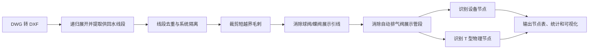

# CAD 图纸转图结构：第一层简化与拓扑预处理方法论

## 1. 目标与适用范围

本方法用于把暖通 CAD 系统图中的绘图实体转换为可计算的图结构。第一层只保留两类节点：

1. **设备节点**：每台带唯一设备编号的非阀门设备折叠为一个节点；
2. **T 型物理节点**：同一管网中真实存在三向连通的分支点。

核心目标不是复刻 CAD 的全部线条，而是恢复其表达的**物理拓扑**。阀门、仪表、标注和为方便阅读而添加的展示线，不应改变最终连通关系。

## 2. 核心原则

### 2.1 区分绘图拓扑与物理拓扑

CAD 中“有三条线在一点相交”不一定代表物理 T 接，常见干扰包括：

- 线段端点略微越过主干线，导致真实 T 接没有精确吸附；
- 球阀、蝶阀被偏置到转角旁，用短线连接回管道；
- 自动排气阀被画在转角延长线上；
- 不同系统管线在二维图上交叉，但并未连通；
- 说明性详图与主系统实例同时出现在模型空间。

因此，节点识别必须在几何检测之前或之后加入语义与局部拓扑校验。

### 2.2 语义优先、几何定位、拓扑验收

每一类预处理遵循同一个三阶段框架：

1. **语义定位**：利用图层、块名、属性标签或设备编号确定对象类型；
2. **几何生成候选**：根据端点、交点、包围盒、距离和角度提出待修正线段；
3. **拓扑验收**：在内存中模拟删除或裁剪，只有局部拓扑变为预期形态时才接受修改。

单凭颜色或短线长度不能直接删除线段。

### 2.3 系统隔离

供水和回水分别建图、分别计算射线与交点。不同系统即使坐标重合，也不能形成同一个 T 节点。

### 2.4 保守修改与可审计

- 每次只修改能够被局部证据充分解释的线段；
- 所有操作记录系统、原端点、目标节点、长度和操作类型；
- 预处理前后都统计节点数量，并通过局部图和全量图复核；
- 无法满足完整判定条件的候选保持原样，交给后续人工或新规则处理。

## 3. 节点定义

### 3.1 设备节点

本图以 `CRAH-4#-楼层-序号` 为设备唯一标识。设备图形无论由完整块还是炸开的轮廓线组成，都与最近的唯一标签匹配，最终整台设备折叠为一个设备节点。

约束如下：

- 每个设备标签只能匹配一个设备中心；
- 每个设备中心只能分配给一个标签；
- 存在未匹配标签或设备数与标签数不一致时，流程直接报错，而不是静默漏计。

### 3.2 T 型物理节点

在同一供水或回水系统内，某点满足以下条件时才计为 T 节点：

1. 汇聚为 **3 条唯一方向射线**；
2. 其中有一对方向相反且共线的射线，代表连续主管；
3. 第三条射线代表支管；
4. 该点不位于已排除的说明性详图区域。

普通弯头只有两条不共线射线，因此不是 T 节点；直通点只有一对反向共线射线，也不是 T 节点。

### 3.3 当前不计为节点的对象

- 球阀、蝶阀、自动排气阀等阀门；
- 软接、仪表、文字和标注；
- 图框及说明性接管详图；
- 普通弯头和管线自由端点。

## 4. 总体处理流程



预处理顺序是方法的一部分。先修复欠连接，再消除设备展示线造成的伪连接，可避免后续规则基于错误拓扑作出判断。

## 5. 管线基础规范化

### 5.1 递归提取

管线可能位于多层嵌套块内。处理时递归展开块引用，将其转换到模型空间坐标后提取 `LINE` 实体。当前递归深度上限为 8 层。

### 5.2 图层到系统的映射

当前图纸中：

- ACI 6 对应冷冻水供水；
- ACI 4 对应冷冻水回水。

颜色仅用于找到图层，后续计算使用明确的 `supply`、`return` 系统标签，不把颜色本身当作物理语义。

### 5.3 线段去重

相同系统、相同两端点的线段按无向边去重。端点以 0.01 个图纸单位量化，避免块展开后产生重复线段。

### 5.4 版式平移适配

楼层分带、说明性详图排除区和可视化视窗不能直接依赖当前文件的绝对坐标。SH16 处理中使用稳定设备标签 `CRAH-4#-1-1` 作为版式锚点，计算它相对基准版的 X、Y 位移，并将全部范围边界同步平移。

这种方法可以处理整张图在模型空间中的平移，同时保持主系统范围和楼层口径不变。若图纸内部版式发生重排，而非整体平移，则需要重新标定范围或升级为语义化图框识别。

## 6. 预处理规则一：短越界毛刺裁剪

### 6.1 问题形态

支管本应终止在主管上，但绘图端点略微越过主管。直接按端点建图时，交点不是候选端点，真实 T 节点会漏检。

### 6.2 候选条件

只有同时满足以下条件才裁剪：

- 支管与主管属于同一系统；
- 两线存在非平行交点，夹角不小于 20°；
- 主管在交点两侧都继续延伸；
- 支管也穿过交点，交点到其某个端点形成短越界段；
- 该端点没有连接到其他同系统管线，是悬空端点；
- 越界长度大于点容差且不超过 10 个图纸单位；
- 越界长度不超过整条支管长度的 10%。

### 6.3 操作与验收

把悬空端点回缩到交点，使交点成为支管端点。该规则只修复“几乎接上但略微越界”的欠连接，不将普通二维交叉自动解释为连通。

## 7. 预处理规则二：球阀、蝶阀转角展示引线消除

### 7.1 问题形态

为提高图纸可读性，阀门符号可能放在管道转角之外，再用一条短的管线颜色引线连接到转角。从纯几何上看，转角出现三条射线，会被误判为 T 节点；物理上这里只是弯头加阀门。

### 7.2 语义定位

递归搜索嵌套块，当前识别以下阀门块名：

- `$VALVE$00000954`
- `H-PICPNT-87`
- `H-PICPNT-91`

使用块在模型空间中的包围盒确定阀门区域，而不是通过绿色符号或管线颜色猜测阀门类型。

### 7.3 候选条件

- 管段长度不超过 200 个图纸单位；
- 管段仅一个端点位于阀门区域内；
- 阀门侧端点不与其他同系统管段相连；
- 删除前，另一端恰好形成 3 射线并包含一对反向共线射线；
- 模拟删除后，该点恰好剩余 2 条不共线射线，即普通弯头。

### 7.4 操作与保护条件

满足全部条件时删除整条短展示引线。若阀门处于真实直管或分支中，阀门侧还会存在其他管线，或者删除后拓扑不成为弯头，因此不会触发该规则。

## 8. 预处理规则三：自动排气阀展示管段消除

### 8.1 问题形态

自动排气阀与球阀、蝶阀一样可能放在转角的视觉延长位置。它与转角间的管线仅表示设备接入，不构成主管上的第三个物理方向。

此类展示管段有两种几何形式：

1. 独立短线：阀门端点到转角是一条单独线段；
2. 连续长线：同一条线穿过转角，阀门侧只是该线的一小段。

### 8.2 语义定位

读取 `ATTDEF` 的语义属性：

- `tag = WHAT`；
- 文本为“自动排气阀”或“自动放气阀”。

属性插入点作为阀门语义端口。该方法不依赖符号颜色或人工框选。

### 8.3 候选条件

- 管段的一端与阀门语义端口重合；
- 同一管段上存在同系统的候选 T 点；
- 端口到该 T 点的距离不超过 1000 个图纸单位；
- 模拟处理后，该点恰好剩余 2 条不共线射线。

### 8.4 操作

- 若阀门端口到转角是独立线段，则删除该线段；
- 若阀门侧是连续线段的一部分，则把线段回缩到转角；
- 若模拟后不是普通弯头，则拒绝修改。

## 9. 预处理规则四：管道上下叠跨越断口复联

### 9.1 问题形态

两根管道在二维图面交叉但物理上不连通。为表达其中一根从另一根上方或下方经过，制图会在被跨越位置把其中一根短暂断开。该断口不是管端，也不是省略符，更不能把交叉位置解释为十字节点或 T 节点。

### 9.2 候选条件

只有同时满足以下条件才复联：

- 断口两端属于同一供水或回水系统，且均为悬空端点；
- 两端相距不超过 250 个图纸单位；
- 两侧入射管段近似共线，且方向背离断口；
- 连接两端形成的短跨越段与另一根管道在双方内部相交；
- 相交夹角不小于 20°；
- 一个端点只参与一处最短、无冲突的跨越复联。

### 9.3 操作与拓扑保护

在断口两端之间补一段同系统语义桥，使被断开的管道恢复连续。交叉点保持为两条路径的内部点：不在交叉点切分任一管段，不合并两条管道的邻接关系，也不生成节点。若只是普通共线断口但中间没有被跨管道，则拒绝自动复联。

SH16 更新版在阀门展示腿和自动放气阀腿清洗后识别出 2 处真实跨越断口：供水 1 处、回水 1 处。原始几何阶段出现的另外 3 个相似候选属于阀门展示结构，语义清洗后自动消失，不进入跨越复联。

### 9.4 弧线跳线表达

有些图纸不采用短断口，而是在一根管道上画短圆弧或带 bulge 的多段线，表示它与另一根管道在二维图面交叉但物理上不连通。该弧仅是视觉避让，不是真实弯管，也不能根据弧线朝向确定实际上下标高。

识别时要求弧端点连接同系统、近似共线的两侧直管，弧的短弦内部与另一根管道相交。归一化时以弧端点间直线恢复所属管道，交叉点不切分、不建节点；原弧只进入制图审计，不参与物理路径长度。普通真实弯管、没有被跨管道的弧以及语义不明确的曲线不得自动拉直。

当前 SH16 更新版的供回水管层中 `ARC=0`、带 bulge 的管道多段线为 0，因此本规则不改变当前节点和边结果。

## 10. T 节点最终检测

完成全部预处理后再识别 T 节点：

1. 将清洗后线段的端点以 0.1 个图纸单位量化，形成候选点；
2. 仅收集该点所在系统的管段；
3. 把共线、同向的线归并为唯一射线，方向角容差为 1°；
4. 要求唯一射线数严格等于 3；
5. 要求其中一对射线方向点积小于 `-0.999`，即近似反向共线；
6. 排除说明性详图区域；
7. 按坐标和系统排序，写入节点清单。

“严格等于 3”可以避免把四通或复杂重叠点误称为 T。复杂节点应在后续节点类型扩展中单独定义。

## 11. 参数配置

以下参数是当前 SH16 图纸的经验值，不应直接视为所有项目的通用常数：

| 参数 | 当前值 | 作用 |
|---|---:|---|
| 点到线容差 | 0.2 | 判断点是否落在线段上 |
| 端点量化粒度 | 0.1 | 合并数值误差下的同一点 |
| 射线角度容差 | 1° | 合并近似同向射线 |
| 毛刺最大绝对长度 | 10 | 限制短越界裁剪 |
| 毛刺最大相对长度 | 10% | 防止误裁正常支管 |
| 毛刺最小相交角 | 20° | 排除近似平行擦边 |
| 跨越断口最大长度 | 250 | 限制上下叠复联候选 |
| 跨越最小相交角 | 20° | 排除近似平行线间的小断口 |
| 阀门展示引线最大长度 | 200 | 限制球阀/蝶阀候选 |
| 自动排气阀展示段最大长度 | 1000 | 限制排气阀候选 |

新图纸应先抽样测量线宽、符号尺度和绘图单位，再标定阈值。

## 12. 验证方法

### 12.1 数量增量核对

每一步都计算 T 节点增量，确认结果与规则目的相符：

- 修复越界毛刺应增加真实 T；
- 消除设备展示线应减少伪 T；
- 未涉及区域的节点不应发生变化。

### 12.2 局部拓扑不变量

修改必须满足明确的前后条件。例如阀门展示线处理采用：

`三射线 T 形候选 → 删除/裁剪展示段 → 两射线非共线弯头`

如果结果变成断线、直通、仍为三射线或出现更多射线，则拒绝修改。

### 12.3 自动化回归测试

当前测试覆盖：

- 短悬空越界段可被裁剪并恢复 T；
- 已连接端点和过长线段不会被误裁；
- 嵌套阀门块能转换到正确世界坐标；
- 阀门展示引线可删除，真实主管分支被保留；
- 自动排气阀语义端口可识别；
- 自动排气阀独立线段可删除；
- 自动排气阀连续线段可回缩。

### 12.4 可视化复核

同时输出全量图和分楼层图，用颜色区分供水 T、回水 T 和设备节点。数量正确但空间分布明显异常时，仍应视为未通过。

## 13. SH16 当前处理结果

| 阶段 | T 节点数 | 本阶段变化 |
|---|---:|---:|
| 原始管线几何初检 | 387 | — |
| 裁剪 9 段短越界毛刺后 | 396 | +9 |
| 消除 92 段球阀/蝶阀展示引线后 | 304 | -92 |
| 消除 4 段自动排气阀展示管段后 | **300** | -4 |

最终结果：

- 设备节点：92；
- T 型物理节点：300，其中供水 151、回水 149；
- 总节点：392。

原始几何初检的 387 个 T 既包含伪 T，也遗漏了未精确吸附的真实 T，因此不能直接作为物理节点总数。

## 14. 新对象类型的扩展模板

未来增加新的设备或符号预处理时，建议按以下模板实现：

1. 定义该对象是否属于物理节点；
2. 优先寻找块名、属性标签或设备编号等稳定语义；
3. 从语义对象确定真实连接端口或影响区域；
4. 生成有限距离和有限角度内的几何候选；
5. 在副本中模拟删除、裁剪、吸附或折叠；
6. 用修改前后的射线数、连通分量和系统归属验收；
7. 记录每次操作的原因、坐标、长度和动作；
8. 增加正例、反例和边界条件测试；
9. 重新生成全量图并核对节点增量。

## 15. 已知边界

- 图层颜色、块名、属性名及基准版式边界目前仍与 SH16 图纸约定有关；
- 版式锚点可以适配整图平移，但不能自动解释各区域相互独立的重排；
- 阈值受 CAD 单位和符号比例影响，需要按项目标定；
- 仅凭二维几何不能可靠判断所有跨线是否连通，必要时需结合断线符号、连接点或设计语义；
- 当前仅定义设备节点和 T 节点，四通、汇流器、管线端点等需在后续图模型中单独扩展；
- 新规则不能只依赖“看起来像”，必须同时具备语义或强几何证据以及拓扑验收条件。

## 16. 对应实现与产物

- 主程序：`src/analyze_graph.py`
- 回归测试：`tests/test_preprocessing.py`
- 节点清单：`outputs/nodes.csv`
- 统计及参数：`outputs/node_summary.json`
- 全量可视化：`outputs/simplified_graph_overview.png`
- 分楼层可视化：`outputs/simplified_graph_by_floor.png`

## 17. 省略连接设备节点落位

设备图形与主图之间存在为排版美观而断开的省略连接。本阶段只确定设备节点应放在哪里，不创建或修改任何边。

### 17.1 落位规则

1. 真正的省略连接设备必须在同一设备源块中包含一对六顶点 `DIM_SYMB` 标记；
2. 距设备图形较近的是设备侧标记，较远的是主图侧标记；
3. 把设备节点坐标迁移到主图侧标记的包围盒中心；
4. 设备编号、楼层和设备类型保持不变；
5. 没有成对省略标记的设备保留原设备坐标；
6. T 节点保持上一阶段的数量和坐标，不受设备节点迁移影响。

### 17.2 边界

- 输出图数据中的 `edges` 固定为空数组；
- 不建立设备—T、T—T 或任何其他边；
- 不提取管径、阀门、软管等边属性；
- 设备节点迁到主图省略符，是为了后续建边时能够沿原始支路提取这些属性，而不是本阶段已经处理了边。

### 17.3 更新版执行结果

- 设备节点：92；
- T 节点：301；
- 总节点：393；
- 62 台具有成对省略标记的设备已迁移到主图侧标记；
- 24 台无省略标记的块设备和 6 台炸开设备保持原坐标；
- 边数量：0，本阶段有意不处理。

对应产物：

- 实现：`src/place_equipment_nodes.py`
- 节点清单：`outputs/updated/equipment_placement_nodes.csv`
- 落位审计：`outputs/updated/equipment_placement_audit.csv`
- 纯节点图数据：`outputs/updated/equipment_placement_graph.json`
- 全量与分层可视化：`outputs/updated/equipment_placement_overview.png`、`outputs/updated/equipment_placement_by_floor.png`

## 18. 相邻节点边与边设备属性

节点落位完成后，以“从一个已建节点出发，在不经过第三个已建节点的前提下，到达下一个已建节点”为一条逻辑边。实体节点基线保持为 92 个设备节点和 301 个 T 节点；未绑定实体设备的主图省略符新增为虚拟外部接口设备。

### 18.1 边类型与方向

1. T–T 边：在同一供水或回水管网内，把两端 T 之间的原始折线压缩成一条逻辑边；
2. T–设备边：每台 CRAH 建立一条供水边和一条回水边，共 184 条；
3. T–虚拟设备边：每个未绑定省略符按实际管线端点建立一个或多个供水/回水端口，每个端口连接沿管路首先到达的 T；
4. 供水设备边记为 `T -> 设备`，回水设备边记为 `设备 -> T`；
5. T–T 边暂未推断水力方向，起终点按节点 ID 稳定排序，并在数据中保留系统字段；
6. 球阀、蝶阀、自动放气阀、软接、过滤器和仪表只作为边设备实例，不增加节点。

### 18.2 省略符复联

带省略符的设备支路在 CAD 中由两段互不接触的几何组成，但物理上是一条边：

- 主图侧：从最近 T 沿原始支路到主图侧 `DIM_SYMB`；
- 设备侧：从设备侧 `DIM_SYMB` 沿原始支路到设备接口；
- 图模型中合并为一条 T–设备逻辑边；
- 属性查询同时覆盖两段原始 CAD 路径；
- 不绘制跨排版区域的合成直线，避免把无关图形误纳入边属性。

未绑定实体设备的六顶点 `DIM_SYMB` 按以下规则处理：

- 每个主图范围内的独立省略符生成一个 `virtual_equipment` 节点，节点落在符号包围盒中心；
- 省略符接触的每个供水/回水管线端点生成一个端口，而不是按图元一对一重复创建设备；
- 一般省略符形成一供一回两个端口；多管外部系统接口允许同一虚拟设备具有多个同系统端口；
- 端口沿管网连接到首先到达的 T，边上原有阀门和软接仍作为属性；
- 无法直接到达 T 的小断口，单端口按最近同系统管线投影保守愈合，多端口按一对一最小代价和空间顺序复联；
- 虚拟节点 ID 和端口 ID写入图数据，后续可人工补充实体语义，或用新设备管路块替换并拼接端口。

金属软管图示造成的管线断口不是新节点。当两个一端接 T 的尾管端点同时邻近金属软接符号、方向相反且同轴时，将两端愈合为 T–T 边，金属软接继续作为该边的设备属性。

### 18.3 图例映射与聚合字段

`sh16-native-table.dwg` 的水系统图例作为符号语义来源。当前系统图实际匹配到：球阀、蝶阀、自动放气阀、金属软接、Y 型汽/水过滤器、压力表、温度计。

同一设备语义可能有两种 CAD 表达。球阀优先按 `H-PICPNT-91` 块参照提取；对于被炸开的球阀，以黄色中心填充为锚点，同时要求邻域内恰有两段椭圆弧和三条满足比例约束的黄色线。只有完整命中该组合模板才生成球阀实例，单独填充、线段或圆弧不作设备处理。块参照与炸开图元按坐标去重后统一进入边归属流程。

每条边在 `equipment_inventory` 中按设备类型聚合：

```json
{
  "equipment_type": "球阀",
  "count": 2,
  "device_names": ["球阀-BV0001", "球阀-BV0002"]
}
```

同时输出规范化表，一行对应一个“边—设备类型”组合，字段为起点、终点、设备类型、数量和实例名称列表。

### 18.4 更新版执行结果

- 节点：422 个，其中实体设备 92、虚拟设备 29、T 节点 301；
- 虚拟设备端口：60 个，其中 55 个直接沿管线接入，1 个小断点愈合，4 个多管端口按顺序复联；
- 边：573 条；
- T–T 边：329 条；
- T–实体设备边：184 条；
- T–虚拟设备边：60 条；
- 供水边：288 条；
- 回水边：285 条；
- 已归并到相邻节点边的设备实例：1560 个，未归属 0 个；
- 球阀：706 个，其中块参照 616 个、炸开图元恢复 90 个；图示 U 形管组恢复 54 个，另一处同构管组恢复 36 个；
- 92 个蝶阀展示引线和 4 个自动放气阀展示管段均回折到所属边，没有生成伪节点；
- 2 处管道上下叠跨越断口被复联（供水 1、回水 1），交叉位置未生成节点；
- 4 处金属软管图示断口被愈合为连续 T–T 边；此前遗漏的 8 个球阀和 6 个金属软接均已归入正确边。

对应产物：

- 实现：`src/build_edges.py`
- 全量节点表：`outputs/edges/topology_nodes.csv`
- 虚拟设备表：`outputs/edges/virtual_equipment_nodes.csv`
- 虚拟端口与 T 绑定表：`outputs/edges/virtual_equipment_ports.csv`
- 未绑定省略符审计：`outputs/edges/virtual_omission_marker_audit.csv`
- 金属软管断口愈合审计：`outputs/edges/inline_metal_hose_gap_bridges.csv`
- 管道跨越断口复联审计：`outputs/edges/pipe_crossover_gap_bridges.csv`
- 管道跨越前后对比：`outputs/edges/pipe_crossover_gap_before_after.png`
- 边主表：`outputs/edges/edges.csv`
- 按类型归并表：`outputs/edges/edge_equipment_by_type.csv`
- 逐实例审计：`outputs/edges/edge_device_instances.csv`
- 节点与边图数据：`outputs/edges/graph_with_edges.json`
- 图例映射：`outputs/edges/legend_edge_type_catalog.csv`
- 全量可视化：`outputs/edges/edge_graph_overview.png`
- 分楼层可视化：`outputs/edges/edge_graph_by_floor.png`
